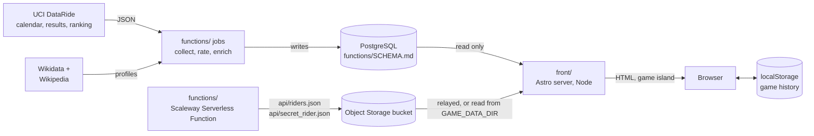

# Ucicle

Two things on one site, `https://www.ucicle.fr`, in French and English:

- **The daily game** (`/jeu/`, `/en/play/`): find the mystery pro cyclist of the day in 5 tries.
  Inspired by [Wordle](https://www.nytimes.com/games/wordle/index.html) and
  [Poeltl](https://poeltl.dunk.town/).
- **The Index Ucicle** (`/`, `/classement/`, `/coureurs/<slug>/`, `/classement/methode/`,
  `/recherche/`, English twins under `/en/`): an Elo-type rating of every men's elite road rider,
  computed from every UCI result since the 2019 season and recomputed every night. A ranking of 50
  riders per page with search, a page per rider (his bib, his index history, his results with the
  calculation of every change, his neighbours and teammates), and a method page that prints every
  parameter.

Product facts: [front/PRODUCT.md](front/PRODUCT.md). Design system: [front/DESIGN.md](front/DESIGN.md).
Maintenance guide for the site: [front/AGENTS.md](front/AGENTS.md).

## Game rules

- **One mystery rider per day**, drawn from the **UCI top 100**, published at 05:00 UTC
  (cron `0 5 * * *`).
- You can guess any rider of the published list: the UCI top 1000, minus riders whose data is
  incomplete (see [functions/README.md](functions/README.md)).
- **5 tries** maximum.
- **Starting hint**: the mystery rider's best result, e.g. *"2 times 1st of the mountains
  classification of Tour de France in 2022 and 2023"*.
- **After each guess**, every attribute is compared to the mystery rider:

  | Attribute            | Feedback on the guess bib                                                        |
  |----------------------|----------------------------------------------------------------------------------|
  | Age, height, weight  | value with its unit; ↑ the mystery rider's is higher, ↓ lower; equal: blue cell with ✓ |
  | Country              | same: blue cell with ✓; different: the code in grey                              |
  | Team                 | on the bib's foot band; same: a blue ✓ tile before the name                      |

  What each try proves is also written on the mystery bib (bounds, country, team).

- **End of game**: right name, win; 5th wrong guess, loss. The mystery bib turns over and shows the
  rider, with a link to his rider page; its number becomes the score (`3/5` or `X/5`). *Partager*
  opens the phone's share sheet (clipboard elsewhere) with a result that never names the rider
  (🔺/🔻: the mystery rider's value is higher/lower, 🟦 same, ⬛ different):
  ```
  Ucicle #1, trouvé en 3/5 🚴
  🔺🔺🔺⬛⬛
  🔺🔺🔺🟦🟦
  🟦🟦🟦🟦🟦
  https://www.ucicle.fr
  ```
- **No account**: the game in progress (`game-progress`), the history and the stats live in the
  browser's `localStorage`, keyed on `secret_rider.json`'s date.

## Architecture



| Folder       | Stack                                                    | Role |
|--------------|----------------------------------------------------------|------|
| `front/`     | Astro 7 (server output, `@astrojs/node`), React 18 island for the game, TypeScript, SCSS, motion, postgres.js | The website. Index pages are rendered on request from PostgreSQL with HTTP caching (ETag = data version); the game and About are prerendered. Serves the game's two JSON files on `/api/*.json`, the search list on `/api/recherche` and hand-written sitemaps. |
| `functions/` | Node 26, TypeScript, postgres.js, axios, AWS S3 SDK      | Two families of jobs. The **index jobs** (`yarn migrate`, `yarn collect`, `yarn rate`, `yarn enrich:wikidata`) fill PostgreSQL. The **game jobs** (a Scaleway Serverless Function, `handler` in [functions/src/index.ts](functions/src/index.ts)) publish the game's files to the bucket. |
| `apex-redirect/` | Scaleway Function | Answers `301` from `https://ucicle.fr` to `https://www.ucicle.fr`. |

### Data jobs (`functions/`)

| Job | What it does | Writes |
|---|---|---|
| `LOAD_RIDERS` (function, cron `0 0 1 * *`) | UCI top 1000 from the UCI World Ranking, height and weight from Wikidata/Wikipedia, best result from each rider's UCI results | `api/riders.json` in the bucket |
| `GENERATE_SECRET_RIDER` (function, cron `0 5 * * *`) | Picks a random rider with UCI rank ≤ 100 from `riders.json` | `api/secret_rider.json` in the bucket |
| `yarn collect --seasons …` / `--recent 14` | Men elite road calendar, races, classifications and results from UCI DataRide since 2019 (full, or the competitions touching the last 14 days) | `competition`, `race`, `classification`, `result`, riders, `job_run` |
| `yarn rate` | Recomputes the whole index from zero and replaces the current version in one transaction | `rating_version`, `rating_change`, `rider_rating`, `ranking_snapshot` |
| `yarn enrich:wikidata` | Display names, height, weight, Wikipedia links by UCI rider id | `rider_profile`, `rider_external_id` |

Details, options and the rating model: [functions/README.md](functions/README.md) and
[functions/SCHEMA.md](functions/SCHEMA.md) (section "Rating engine").

### Game data contract

```ts
Rider       = { rank, name, country, age, weight, height, team, bestResult }
BestResult  = { race, rank, raceType: 'GC' | 'Point GC' | 'KOM' | 'stage' | 'race', recurrence, years[] }
GameSession = { date: 'YYYYMMDD', rider }   // content of secret_rider.json
```

These types are **duplicated** in `front/src/types/` and `functions/src/types/`. Change both
together. (`front/` also accepts `'Points GC'`, the value found in the live data.)

### Repository layout

```
.github/workflows/  ci.yml: yarn ci for front/ and functions/ on every push and PR; cd.yml: deploy on master
apex-redirect/      the apex redirect function
front/
  astro.config.mjs  server output, Node adapter, trailing slashes
  src/pages/        routes, one file per route and language (FR paths, EN under en/), api/, sitemaps
  src/views/        one folder per page: the view (*View.astro) and its loader (load.ts)
  src/layouts/      Base.astro: head tags, header, footer
  src/components/   shell/ (Header, Footer), index/ (StartList, Delta), search/, and the game's bib system
  src/server/       db.ts (PostgreSQL), http.ts (cache headers), index-data.ts, gameData.ts, sitemaps.ts
  src/content/      every visible string, FR and EN, same keys
  src/i18n/         language, formatters, race and championship names
  src/app/          nav.ts (paths, sections), the game island and the game page
  src/game/ panels/ data/ motion/ types/   game logic, Help and Stats panels, game API, motion tokens
  assets/scss/      _tokens.scss (design tokens), components/, pages/, panels/
  scripts/          launch-facts.json and launch-guard.js (owner facts), snapshot.mjs
functions/
  migrations/       numbered SQL files (yarn migrate)
  src/cli/          migrate, collect, rate, calibrate, enrich
  src/collect/      DataRide collector
  src/rating/       the rating engine and its frozen parameters (params.ts)
  src/enrich/       Wikidata enrichment
  src/index.ts      serverless handler of the game jobs; handlers/, scrappers/, s3/
```

## Running locally

Node 26 (LTS) and Yarn; each part pins its version in its own `.nvmrc`
([front/.nvmrc](front/.nvmrc), [functions/.nvmrc](functions/.nvmrc)). A PostgreSQL server; the
schema uses no extension.

1. Create a database and export its URL in the shell (both parts read `DATABASE_URL` at run time):

   ```bash
   createdb ucicle
   export DATABASE_URL=postgres://user@127.0.0.1:5432/ucicle
   ```

2. Fill it with the index jobs:

   ```bash
   cd functions && yarn && yarn build
   yarn migrate                                        # applies the pending migrations
   yarn collect --seasons 2027,2026,2025,2024,2023,2022,2021,2020,2019
   yarn enrich:wikidata                                # optional: names, height, weight, Wikipedia links
   yarn rate                                           # computes the index
   ```

   A full collection is long (DataRide answers in seconds per request, 4 requests in flight at
   most); `--limit-competitions N` collects a sample. Raw responses are archived under
   `functions/.data/raw` (`RAW_ARCHIVE_DIR`).

3. Start the site:

   ```bash
   cd front && yarn && yarn start                      # http://127.0.0.1:4321
   ```

   The game's files are relayed from the production bucket by default; set `GAME_DATA_DIR` to a
   folder holding `riders.json` and `secret_rider.json` to read them from disk instead.
   `node scripts/snapshot.mjs` builds the site, runs it and saves the HTML of every route into
   `front/snap/` (see [front/AGENTS.md](front/AGENTS.md)).

The game jobs can also run locally:

```bash
# Builds the riders list into build/riders.local.json, without touching the bucket
cd functions && yarn build && yarn load:local
# Runs both game jobs. Needs functions/.env (ACCESS_KEY, SECRET_KEY, DOMAIN, REGION, BUCKET_NAME) and WRITES to the bucket
node build/main.js
```

## Deployment

The Astro server, PostgreSQL and the schedule of the index jobs (`yarn collect --recent 14`, then
`yarn rate`, every night): [deploy/README.md](deploy/README.md).

The game function is deployed by the `deploy_functions` job of
[cd.yml](.github/workflows/cd.yml) on push to `master` (`yarn cd` in `functions/`: sets the Scaleway
Function runtime from `.nvmrc`, zips `build/` and `node_modules`, deploys to `FUNCTION_ID`). Its
crons and memory are configured in Scaleway, not in this repository.

## Conventions

- CI runs `yarn ci` in both parts: `front/` installs, lints (ESLint), checks types (`astro check`)
  and builds; `functions/` installs, lints and builds.
- Every UI string goes in `front/src/content/`, in **both** languages
  (see [front/AGENTS.md](front/AGENTS.md)).
- Keep the `Rider` types in sync between `front/` and `functions/`.
- A change to the index's parameters (`functions/src/rating/params.ts`) is a new published index:
  run `yarn rate` and date it (functions/README.md).
- `yarn build` in `front/` lists the facts the owner still has to supply
  (`front/scripts/launch-facts.json`, and the `OWNER:` markers of `front/src/content/`).

## License

[MIT](LICENSE)
