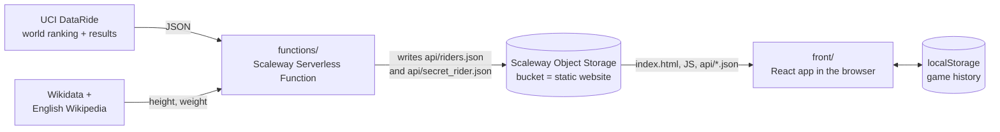

# Ucicle

Daily guessing game: find the mystery pro cyclist of the day in 5 tries.
Inspired by [Wordle](https://www.nytimes.com/games/wordle/index.html) and [Poeltl](https://poeltl.dunk.town/).

## Rules

- **One mystery rider per day**, drawn from the **current UCI top 100** (riders whose team, height, weight and best result are known). A new one is published every day at 05:00 (cron `0 5 * * *`).
- You can guess any rider from the **current UCI top 1000**, and any **former top 100 rider of a UCI ranking since 2016**, retired ones included (Froome, Nibali, Valverde…). A rider who left the ranking keeps their last UCI team; a rider of a club or a national team shows *Sans équipe UCI*.
- **5 tries** maximum.
- **Starting hint**: the mystery rider's best result, e.g. *"2 times 1st of the mountains classification of Tour de France in 2022 and 2023"*.
- **After each guess**, every attribute is compared to the mystery rider:

  | Attribute            | Feedback on the guess bib                                                        |
  |----------------------|----------------------------------------------------------------------------------|
  | Age, height, weight  | value with its unit; ↑ the mystery rider's is higher, ↓ lower; equal: blue cell with ✓; `?` in grey when the data has no height or weight for the guessed rider |
  | Country              | same: blue cell with ✓; different: the code in grey                              |
  | Team                 | on the bib's foot band; same: a blue ✓ tile before the name                      |

  What each try proves is also written on the mystery bib (bounds, country, team).

- **End of game**: right name → win. 5th wrong guess → lose. The mystery bib turns over and shows the rider; its number becomes the score (`3/5` or `X/5`). *Partager* opens the phone's share sheet (clipboard elsewhere) with a result that never names the rider (🔺/🔻: the mystery rider's value is higher/lower, 🟦 same, ⬛ different, ⬜ unknown):
  ```
  Ucicle #1, trouvé en 3/5 🚴
  🔺🔺🔺⬛⬛
  🔺🔺🔺🟦🟦
  🟦🟦🟦🟦🟦
  https://www.ucicle.fr
  ```
- **No account**: the game in progress (`game-progress`), the history and the stats (games played, win rate, streaks, distribution) live in the browser's `localStorage`, keyed on `secret_rider.json`'s date.

## Architecture



**No backend at runtime.** The bucket serves the static site *and* the two JSON files. All game logic (comparisons, win/lose, stats) runs in the browser.

| Folder       | Stack                                        | Role                                                      |
|--------------|----------------------------------------------|-----------------------------------------------------------|
| `front/`     | React 18, TypeScript, Vite, SCSS, motion     | Game UI, FR (`/`, `/a-propos/`) and EN (`/en/`, `/en/about/`). Reads `/api/*.json`, stores history locally. Design: [front/DESIGN.md](front/DESIGN.md). |
| `functions/` | Node.js, TypeScript, axios, AWS S3 SDK       | Collects rider data and publishes the game files to the bucket. |

### Data jobs (`functions/`)

A single entry point, `handler` in [functions/src/index.ts](functions/src/index.ts), routes on `body.action`:

| Action                  | Cron                  | What it does                                                                                       | Output                 |
|-------------------------|-----------------------|----------------------------------------------------------------------------------------------------|------------------------|
| `LOAD_RIDERS`           | `0 0 1 * *` (monthly) | Loads the current UCI top 1000 and the former top 100 riders of every ranking since 2016 from the UCI World Ranking, height/weight from Wikidata/Wikipedia (null when unknown), and the best result of the secret rider candidates from their UCI results ([sources](functions/README.md#data-sources)). Drops only riders without country. | `api/riders.json`      |
| `GENERATE_SECRET_RIDER` | `0 5 * * *` (daily)   | Picks a random rider with UCI rank ≤ 100 from `riders.json`.                                       | `api/secret_rider.json`|

### Data contract

```ts
Rider       = { rank, name, country, age, weight, height, team, bestResult }
              // rank null: former rider out of the ranking; weight, height null: unknown; team null: no UCI team;
              // bestResult only for the secret rider candidates (current top 100 with height and weight), null otherwise
BestResult  = { race, rank, raceType: 'GC' | 'Point GC' | 'KOM' | 'stage' | 'race', recurrence, years[] }
GameSession = { date: 'YYYYMMDD', rider }   // content of secret_rider.json; rider is always complete
```

⚠️ These types are **duplicated** in `front/src/types/` and `functions/src/types/`. Change both together.

### Repository layout

```
.github/workflows/  ci.yml: lint + build on every push/PR · cd.yml: deploy on master
front/                one static HTML per page and language (index.html, en/, a-propos/, en/about/)
front/src/
  app/              App shell, context (language, panels, live region), nav config (data sections declared, hidden)
  pages/            game/GamePage.tsx (the board), about/AboutPage.tsx
  panels/           help/, stats/ (opened from the header, #help / #stats)
  components/       the bib system: MysteryBib, GuessBib, Cell, Pin, RiderCombobox, FactsBand, Panel…
  game/             compare, knowledge, storage, stats, share, stage number, useGame
  content/          every visible string, FR and EN (common.ts, help.ts, about.ts, stats.ts)
  data/ i18n/ motion/ types/   API, countries, formatters, motion tokens, Rider, GameSession…
front/assets/scss/    _tokens.scss (the design tokens), components/, pages/, panels/
functions/src/
  index.ts          serverless handler (action router)
  main.ts           local run: LOAD_RIDERS then GENERATE_SECRET_RIDER
  handlers/         one file per action
  scrappers/        UCI DataRide and Wikidata/Wikipedia clients, best result
  s3/               upload to the bucket
```

## Getting started

Node 26 (LTS) and Yarn. Each part pins its version in its own `.nvmrc` ([front/.nvmrc](front/.nvmrc), [functions/.nvmrc](functions/.nvmrc)).

```bash
# Front: http://localhost:5173, /api is proxied to the production bucket
cd front && yarn && yarn start
```

```bash
# Functions: builds the riders list locally into build/riders.local.json, without touching the bucket
cd functions && yarn && yarn build && yarn load:local
# Runs both jobs locally. Needs a .env (see below) and WRITES to the bucket.
node build/main.js
```

## Deployment

Automatic on push to `master` ([cd.yml](.github/workflows/cd.yml)), each part runs `yarn cd`:

- **front**: `vite build`, then uploads `build/` to the bucket (public-read).
- **functions**: sets the Scaleway Function runtime from `.nvmrc` (`node26`), zips `build/` + `node_modules`, uploads it to the Scaleway Function `FUNCTION_ID` and deploys it.

| Variable       | Used by          | Description                               |
|----------------|------------------|-------------------------------------------|
| `ACCESS_KEY`   | front, functions | Scaleway access key (secret)              |
| `SECRET_KEY`   | front, functions | Scaleway secret key (secret)              |
| `DOMAIN`       | front, functions | Object Storage endpoint domain            |
| `REGION`       | functions        | Scaleway region (e.g. `fr-par`)           |
| `BUCKET_NAME`  | front, functions | Bucket hosting the site and the JSON files |
| `FUNCTION_ID`  | functions (CD)   | Scaleway Function to deploy               |

The function's crons and memory (4 GB min) are configured in Scaleway, not in this repo.

### Hosting (Scaleway project `ucicle`)

| Piece                          | Configuration                                                                                                                                                        |
|--------------------------------|------------------------------------------------------------------------------------------------------------------------------------------------------------------------|
| `https://www.ucicle.fr`        | Edge Services pipeline `ucicle-fr` (Starter plan): managed Let's Encrypt certificate → bucket `ucicle.com` in website mode, no cache stage. Its `www` CNAME is managed by Edge Services, don't edit it. |
| `https://ucicle.fr`            | `ALIAS` → function `ucicle-apex-redirect` (custom domain `ucicle.fr`, managed certificate), which answers `301` to `https://www.ucicle.fr` + path. Source: [apex-redirect/handler.js](apex-redirect/handler.js), deployed by hand. The Edge Services Starter plan allows a single domain (head stage), hence this function for the apex. |
| Bucket `ucicle.com`            | Site + `api/*.json`, public read.                                                                                                                                     |
| Function `ucicle-load-riders`  | Namespace `functions-ucicle`. Crons (UTC): `load-riders` `0 0 1 * *`, `secret-rider` `0 5 * * *`. Secrets `ACCESS_KEY`/`SECRET_KEY` = IAM application `ucicle-function` (Object Storage on the project). |
| GitHub `ACCESS_KEY`/`SECRET_KEY` | IAM application `ucicle-ci` (Object Storage + Functions on the project).                                                                                            |

## Conventions

- CI (`yarn ci`: ESLint + build) must pass for both `front/` and `functions/`.
- Every UI string goes in `front/src/content/`, in **both** languages (see [front/AGENTS.md](front/AGENTS.md)).
- Keep the `Rider` types in sync between `front/` and `functions/`.
- Design rules, tokens and components: [front/DESIGN.md](front/DESIGN.md). Before launch, `yarn build` lists the facts the owner still has to supply (`front/scripts/launch-facts.json`).

More details: [front/README.md](front/README.md) · [functions/README.md](functions/README.md)

## License

[MIT](LICENSE)
